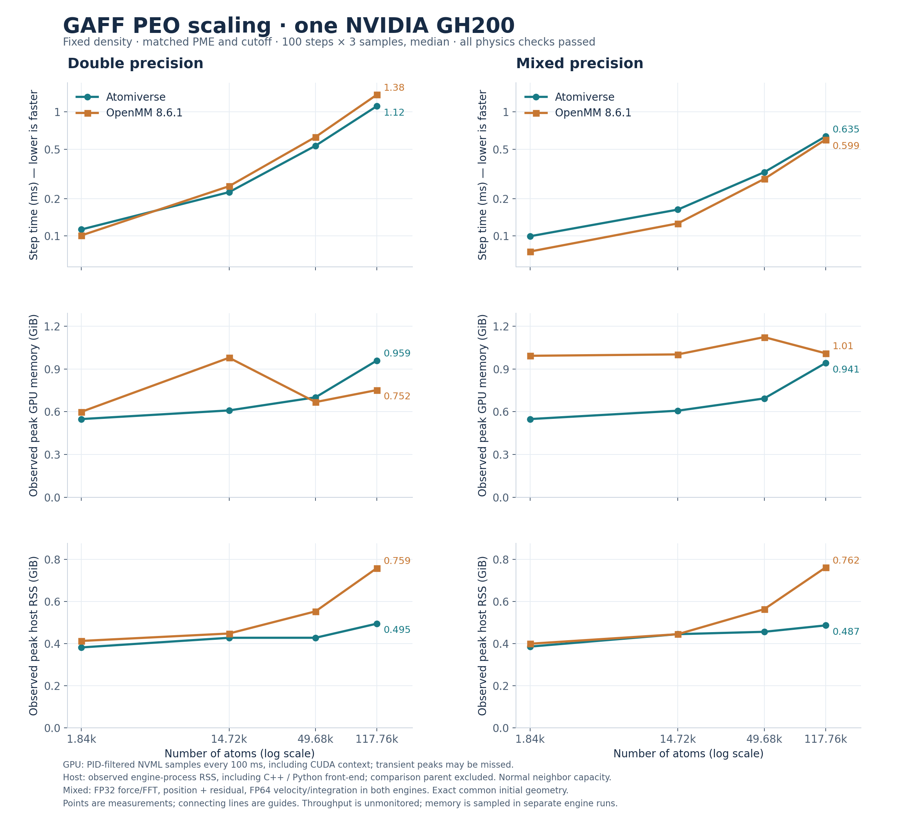

# GAFF PEO on one GH200

Matched Atomiverse and OpenMM 8.6.1 CUDA calculations on Arrhenius. Each
point is the median of three 100-step samples after 10 warmup steps;
0.25 fs unconstrained NVE, fixed density, 9 Å cutoff and order-5 PME.
Initial energy/forces and the final 310-step state pass the standing
acceptance limits. Each engine process, including setup, has a ten-second
deadline. Throughput has no concurrent memory monitor; memory comes from
separate identical engine runs.

| Atoms | Mixed ATV / OpenMM (ms/step) | Double ATV / OpenMM (ms/step) |
| ---: | ---: | ---: |
| 1,840 | 0.0993 / 0.0748 | 0.1127 / 0.1008 |
| 14,720 | 0.1630 / 0.1261 | 0.2254 / 0.2517 |
| 49,680 | 0.3266 / 0.2881 | 0.5342 / 0.6286 |
| 117,760 | 0.6352 / 0.5986 | 1.1150 / 1.3784 |

At 117,760 atoms, mixed step time is 6.1% higher than
OpenMM; double step time is 19.1% lower. Small systems
retain a larger mixed-mode gap; these results do not establish full speed parity.
Maximum final periodic coordinate error is 2.99e-05 Å
in mixed mode and 2.38e-07 Å in double mode.



[SVG](plots/gaff_scaling.svg) · [CSV](plots/gaff_scaling.csv) ·
[Targeted validation](VALIDATION.md).
The eight `summary.json` files retain input and executable hashes,
actual meshes, precision-state metadata, physics errors and process times.
The captured engine stdout is omitted; numerical measurements are unchanged.

GPU memory is the observed process peak including context, sampled every
100 ms; brief peaks can be missed. Host RAM is the observed process VmHWM,
including the C++ or Python front-end. The connecting lines are guides;
nonmonotonic setup-memory peaks are retained as measured.

Mixed mode uses FP32 force/FFT work, position main plus residual and FP64
motion in both engines. It does not imply identical force reductions or
bitwise trajectories. The [protocol](../../README.md) defines the supported
GAFF terms and acceptance thresholds; this fixture does not establish every
GAFF molecule or variable-cell PME workflow.

Regenerate from this directory's summaries with:

```sh
python tools/bench_gaff_openmm/plot_scaling.py tools/bench_gaff_openmm/results/gh200 --out tools/bench_gaff_openmm/results/gh200/plots
```
